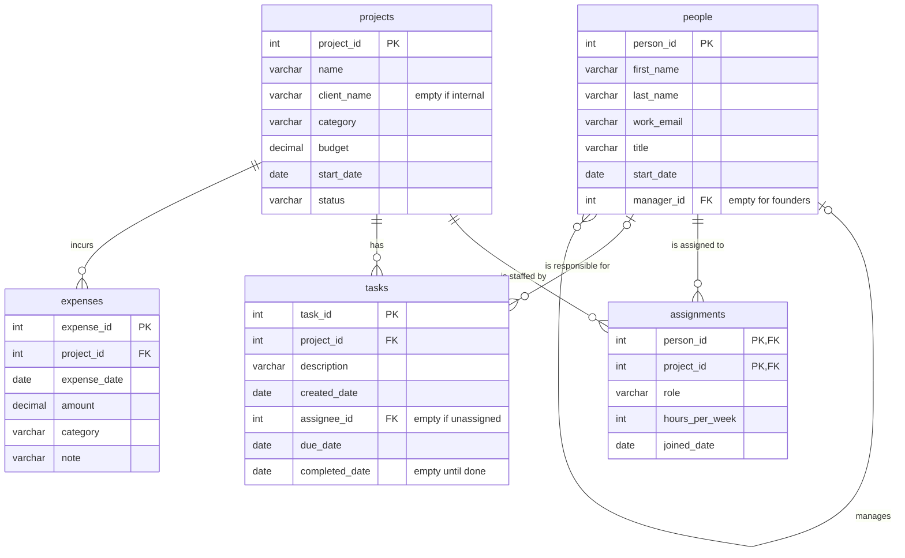

# BabsonAI Labs Database

## 1. The scenario
BabsonAI Labs is a startup founded by Babson students that builds AI tools for small businesses and has about 25 people. It tracks people, projects, assignments, tasks, and expenses in spreadsheets and chat threads, making it hard to check whether someone assigned a task works on that project or add up their hours without doing it by hand. The founders want to see who works on each project, how much each project spends compared to its budget, and who commits more than 40 hours a week across active projects.
How can a database help BabsonAI Labs track project assignments, spending against budgets, and weekly hours per person?

## 2. The ERD

## 3. What one row of each table means
people: One row in people is one person who works at BabsonAI Labs, identified by a unique person_id.
projects: One row in projects is one project, identified by a unique project_id.
assignments: One row in assignments is one person’s commitment to one project, identified by the pair person_id and project_id.
tasks: One row in tasks is one piece of work that belongs to exactly one project, identified by a unique task_id.
expenses: One row in expenses is one expense charged to exactly one project, identified by a unique expense_id.

## 4. Design choices

